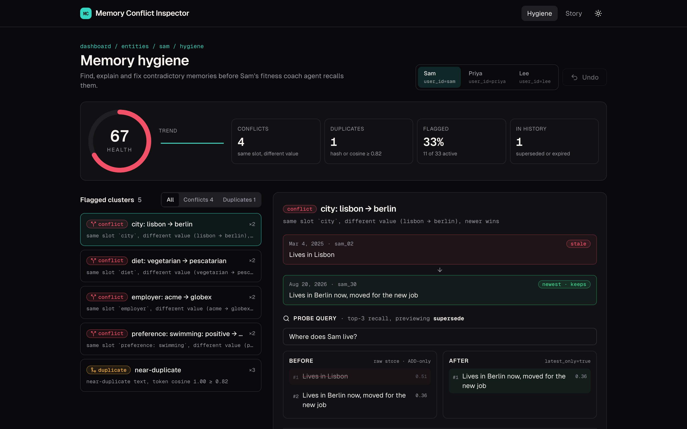
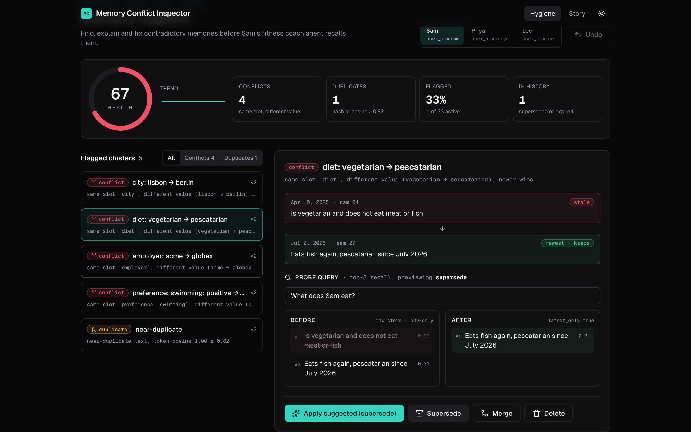
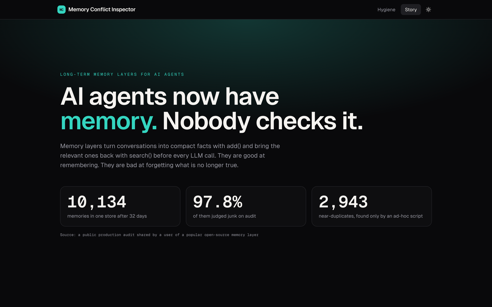

# Memory Conflict Inspector

**A hygiene view for AI agent memory: find, explain and fix contradictory memories before your agent recalls them.**



| Inspector: cluster + recall preview | Story: the animated explainer at `/story` |
|---|---|
|  |  |

## The problem

Long-term memory layers for AI agents work like this: `add()` extracts compact facts ("memories") from conversations, and `search()` returns the relevant ones before each LLM call. They are good at remembering and bad at forgetting what is no longer true.

Many memory pipelines are **ADD-only**, and their dedup is an exact hash match. When a user's facts change, the old fact stays. Users of popular tools in this space report the same failures in public:

- "Works at Company A" and "Works at Company B" both survive, and recall can rank the stale one first
- A favourite changes (Ronaldo → Messi), but the agent keeps citing the old one
- Community cron scripts that cluster near-duplicates at cosine ≥ 0.82 and merge them, in threads with dozens of comments
- A production audit of 10,134 memories after 32 days that found **97.8% junk**, including 2,943 near-duplicates
- Requests for built-in semantic conflict resolution, closed as not planned

Newer memory APIs are adding `latest_only`, superseded memories, `expiration_date` and `history()`. Those are API flags, though. Nothing **shows** a developer which memories conflict, why, or what the agent would recall after a cleanup. An agent that gives bad advice from stale memory looks exactly like one that gives good advice, so the failure stays silent.

## Why this feature

I considered two options:

- **A retrieval explainer** ("why did this memory rank first?"). Doing this honestly needs a vendor's private ranking signals, so a mock would be guesswork.
- **A conflict inspector** (chosen). It is the most-discussed open pain, it can be built faithfully with deterministic detection, and it builds on the supersede/expire/history model that memory layers are converging on instead of competing with it. It is also safe by design: by default nothing is deleted.

## What it does: detect → preview → resolve

1. **Detect.** For one entity (`user_id`), find:
   - **conflicts**: same attribute slot (`employer`, `city`, `diet`, `plan`, `shoe_size`, `favorite_*`, `preference:<thing>` polarity, …) with a different value
   - **duplicates**: an exact hash match, or token cosine ≥ 0.82

   Each cluster comes with a readable reason, e.g. ``same slot `employer`, different value (acme → globex), newer wins``.
2. **Preview recall.** A probe query (for example "Where does Sam live?") runs top-3 recall against the raw store (what an ADD-only pipeline sees) and against a simulated post-fix store with `latest_only`. The two results appear side by side. In the seed, stale "Lives in Lisbon" ranks **#1**, above "Lives in Berlin now".
3. **Resolve** in one click, with undo:
   - **Supersede** (default for conflicts): keep the newest. Older members get `metadata.superseded_by` and `expiration_date = today`, an `UPDATE` is written to history, and nothing is deleted.
   - **Merge** (default for duplicates): `update()` the newest with deterministic, de-duplicated text, then supersede the rest.
   - **Delete**: hard-delete all but the newest, behind a confirm dialog. A `DELETE` event is recorded in history.

**Why supersede rather than delete?** Old facts like "Fully healed knee injury" or "Allergic to nuts" must not be lost. Supersede keeps `history()` intact and can be undone.

## Measured impact

These numbers are computed live by `lib/health.ts#measureImpact` on the seeded store. They are not hard-coded.

| user `sam` | before | after |
|---|---|---|
| Health score | 67 | 100 |
| Probes with a stale fact in top-3 recall | 4 / 7 | 0 / 7 |
| Tokens recalled across the probes | 102 | 67 (−34%) |

They are demo numbers on seeded data, not claims about any production system.

## How it works

```
src/lib/
  text.ts      normalize, tokenize (stopwords + light stemming), tokenCosine, hashText, countTokens
  slots.ts     rule-based attribute slots (multi-valued facts like allergies never collide)
  detect.ts    detectClusters(): slot rules first, then union-find over hash / cosine ≥ 0.82
  resolve.ts   applyResolution(store, cluster, 'supersede' | 'merge' | 'delete'), undo()
  recall.ts    recall(memories, query, { k, latestOnly }): cosine + small recency boost
  health.ts    healthScore = round(100 · (1 − flagged / active)), hygieneStats, measureImpact
  store/       MemoryStore interface + InMemoryMemoryStore (snapshot stack for undo)
src/app/
  hygiene/     the Inspector
  story/       animated explainer (framer-motion, respects prefers-reduced-motion)
  api/memories GET ?user_id=  -> { results }
  api/hygiene  GET ?user_id=  -> { clusters, score, stats }
```

**Plugging in a real memory backend.** All memory access goes through the `MemoryStore` interface in `src/lib/store/memory-store.ts`, which follows the usual memory-layer API shape (`get_all`, `update`, `delete`, `history`). To run against a real deployment, implement that interface with your memory service's client or a self-hosted REST server. A real embedder would plug in at `tokenCosine`. The demo needs no key. `.env.example` documents `MEMORY_API_KEY` for that swap.

## Run it

```bash
pnpm i
pnpm dev            # http://localhost:3000/story and /hygiene
pnpm test           # Vitest + Testing Library
pnpm test:coverage  # ~99% lines on src/lib
pnpm typecheck && pnpm lint && pnpm build
```

The app makes no network calls and needs no API keys. "Now" is frozen to 2026-10-21 so results are deterministic.

## Stack

**Next.js 15 App Router**, **React 19**, **TypeScript** (strict), **Tailwind 3** + `tailwindcss-animate`, shadcn-style **Radix** primitives (dialog, tabs, tooltip), **framer-motion 12**, **lucide-react**, **sonner**, **recharts**, **zod**, and **pnpm**. Tests use **Vitest** + Testing Library + jsdom.

## Limitations / next steps

- LLM-assisted merge text instead of the deterministic sentence join
- A server-side endpoint so detection runs next to the database and vector store
- Real embeddings for duplicate detection, plus slot extraction from fact categories
- Scheduled hygiene reports and a webhook when the health score drops

---

Built with [Claude Code](https://claude.com/claude-code). An independent project.
